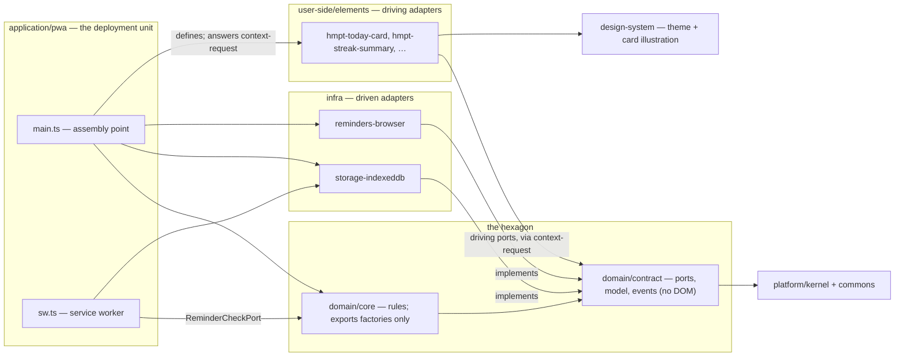

# How Many Pages Today

An offline-first PWA that deals you one reading challenge a day: a card, bound like an old
leather book, with an illustrated plate and a number of pages in gold. Read them, press the
button, and the card is sealed with wax. Keep the candle burning.

The room it lives in is an old library on an autumn afternoon — parchment, leather and gilt,
dusty shelves, lamplight, pillows and a blanket — and, after dusk, the same room by lamplight.

- **A card a day.** The page count is drawn from a range you control — by default 10 to 100
  in steps of ten. The plate is one of six cosy library scenes (dusty shelves, a banker's
  lamp, a window seat of pillows, a wingback armchair, a rainy windowsill, a candlelit
  still life) painted from a seed, so the same day always shows the same card, online or not.
- **The book of the day.** The day's card waits on the table as a closed book — a leather
  cover, the date, a gilt emblem — until it is tapped. Then the camera pulls back as the cover
  swings open and slips beneath the first pages: the open book shows the two days before
  (their plates and what was read; a new book shows its Ex libris and "Chapter One"), and
  pushes in again while yesterday's page turns, landing on today's page — a printed page with
  a running head, the illustration as a captioned plate, the number in ink, a folio at its foot.
  Once the reading is logged the camera pulls back, today's page turns to the marbled inside
  of the back board, and the book is turned over onto its back cover as the camera pushes in:
  sealed in wax, with a warm note from the librarian (by chance, but the same all day: a goal
  met, gone beyond, a short day, a book finished) and the streak or any bookplate earned.
  "Open the book" turns back to the page to add pages read later. Instant with reduced motion.
- **Log what you actually read.** One tap logs the day's goal; or enter the real count —
  more or fewer pages. Any reading keeps the streak alive (every page counts); the goal is
  met at the goal or beyond, or by finishing a book. A day read stays read — there is no
  undo — but you can always add pages read later the same day.
- **Gamified.** Current and best streak (a candle), pages read, books read, a ten-rank reader
  level, twenty-three achievements as bookplates — including ones for reading beyond the
  goal, twice the goal, 100 bonus pages all told, a 200-page day, a short day logged
  honestly, and finishing a book on the day — a six-week ledger (short days half-bound,
  days beyond the goal starred), and a flurry of autumn leaves when you finish.
- **Your shelf.** Put a book on the nightstand, or not: a book can be marked finished from
  the shelf or from the day's card, with or without a title. Each keeps when it was started
  and finished.
- **A bookmark.** Say which page you are at when you put a book on the nightstand (and, if
  you like, how many pages it has). The day's card then tells you the page to read up to —
  your bookmark plus the day's goal, stopping at the last page — and every page you log moves
  the bookmark on. The nightstand shows where it sits and how far into the book that is; it
  can be moved by hand. Reach the last page and the card offers to put the book on the shelf.
- **English and French.** The reading room speaks the language of your browser (French
  for a French browser, English otherwise), or the one you pick under *You → Language* — or
  at the door, on a first visit. Dates and numbers follow; so does the reminder notification.
- **Looking back.** A month or a year at a time: pages read, days read and books finished
  against the period before; a chart of pages per day (with each day's goal marked) or per
  month; the best day or month, the longest run, goals met, pages beyond the goal; and the
  books finished, with their dates. Every value is also in a table view.
- **A profile that never leaves the phone.** Name, avatar, favourite genre — stored in the
  browser's IndexedDB. There is no server.
- **Typography.** EB Garamond and IM Fell English, free fonts under the SIL Open Font
  License, bundled as latin subsets and precached — the look survives offline. Their
  licences ship with the site under `/licenses/`.
- **Daily reminder.** A notification at a fixed hour until you have read; plus a one-tap
  calendar event as the reminder that never misses (see [Reminders](#reminders)).
- **A first visit told as a story.** The librarian greets a new reader at the door, takes
  down their reader's card, asks what is on their nightstand, shows them round the room
  with a lamplit spotlight on the real interface, offers a key to the room (installing the
  app: the browser's own prompt where there is one, illustrated *Share → Add to Home Screen*
  steps on iPhone and iPad), and hands them their first card. Skippable at any point
  (Escape works), shown once, and replayable from the reading room.
- **Installable and offline.** Every asset is precached by the service worker.

## Run it

```bash
npm install
npm run dev          # http://localhost:5173/how-many-pages-today/
npm run verify       # typecheck + architecture lint + unit tests + build
npm run e2e          # Playwright against the production build
```

Node 24+ (CI runs the current LTS, 26). The end-to-end suite needs the Chromium matching
its Playwright version (`npx playwright install chromium`), or point
`PLAYWRIGHT_CHROMIUM_PATH` at a Chromium you already have.

## Deploy

`.github/workflows/pages.yml` verifies every pull request and every push to `main`, and
deploys to GitHub Pages **only from `main`** — on a push to it, or a manual run of the
workflow on it. Pull requests are verified, never published. Every action is pinned to a full commit
SHA, with the release tag in a comment. One-time setup: *Settings → Pages →
Build and deployment → Source: **GitHub Actions***. The app is then served at
`https://<owner>.github.io/how-many-pages-today/` (change `BASE_PATH` for another host).

## Reminders

A static site has no push server, so the web offers exactly one way to wake an app that
is closed: **Periodic Background Sync** — installed PWAs on Chromium (Android Chrome,
desktop Chrome/Edge), at a cadence the browser decides (roughly, not to the minute).

| Where | What you get |
|---|---|
| Android, app installed | A background reminder around the chosen hour. |
| iPhone/iPad, added to Home Screen | A reminder at the exact hour **while the app is open**; no background wake-up exists for web apps without a push server. |
| Anywhere | **Add to my calendar**: a daily recurring event with an alarm, generated on the device. Your phone's calendar rings it, on the dot, every day. |

A real push server (Web Push) would make background reminders exact on every platform; it
is the natural next step if the app ever gets a backend. See
[ADR 0002](docs/adr/0002-reminders-without-a-server.md).

## Architecture

The house hexagonal reference for the frontend, `basic` layout (one bounded context: the
reading challenge), as an npm workspace. Custom elements are the driving adapters, every
browser capability sits behind a driven port, and the domain compiles without the DOM.
Layout comes from [`@rgoussu.dev/planks`](https://www.npmjs.com/package/@rgoussu.dev/planks).



| Package | Role |
|---|---|
| [`platform/kernel`](platform/kernel) | `Result`, the `Clock`/`RandomSource`/`LanguageSource` port types, the Context protocol |
| [`platform/commons`](platform/commons) | System clock, `Math.random`, the device's languages |
| [`domain/contract`](domain/contract) | Model, driving & driven ports, domain events |
| [`domain/core`](domain/core) | Page draws, streaks, levels, the bookshelf and its bookmark, achievements, the monthly/yearly overview, reminder policy, the language; in-memory fakes |
| [`design-system`](design-system) | The library theme over planks tokens, bundled fonts; `<hmpt-ds-scene>`, the seeded illustration |
| [`user-side/elements`](user-side/elements) | Port-bound custom elements, their context keys, and the English and French phrasebooks |
| [`infra/storage-indexeddb`](infra/storage-indexeddb) | Every repository port on one IndexedDB database |
| [`infra/reminders-browser`](infra/reminders-browser) | Notification permission, periodic sync, notifications |
| [`infra/install-browser`](infra/install-browser) | Installing the app: Chromium's install prompt, iOS instructions, installed detection |
| [`application/pwa`](application/pwa) | `index.html` + `main.ts` + router + service worker |

The walls and what enforces them:

| Rule | Enforced by |
|---|---|
| The domain never touches the browser | domain packages compile with `"lib": ["ES2022"]` — `document`, `fetch`, `HTMLElement` do not exist there (tsc) |
| Only the assembly sees the core; adapters talk to the contract | dependency-cruiser |
| Adapters never import each other; the design system is domain-blind | dependency-cruiser |
| No relative import escapes its package (which would bypass `exports`) | dependency-cruiser |
| The core's internals stay internal | `domain/core`'s `exports` map: factories (and `./testing`) only |

The workspace graph enforces nothing on its own — dependency-cruiser does, and it has been
checked to fire on planted violations. It parses with SWC: TypeScript 7.0's API lacks what
its tsc parser needs, so it prints a `missing-tsc-transpiler` warning until TypeScript 7.1 —
expected, and harmless. Decisions are recorded in [`docs/adr`](docs/adr).
