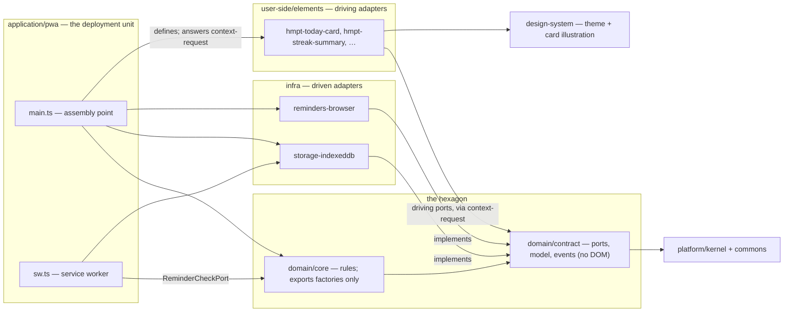

# How Many Pages Today

An offline-first PWA that deals you one reading challenge a day: a card, bound like an old
leather book, with an illustrated plate and a number of pages in gold. Read them, write the
page you stopped at, and the librarian writes the day on a scroll and seals it in wax — red,
orange or gold. Keep the candle burning.

The room it lives in is an old library on an autumn afternoon — parchment, leather and gilt,
dusty shelves, lamplight, pillows and a blanket — and, after dusk, the same room by lamplight.

- **A card a day.** The page count is drawn from a range you control — by default 10 to 100
  in steps of ten. The plate is one of six cosy library scenes (dusty shelves, a banker's
  lamp, a window seat of pillows, a wingback armchair, a rainy windowsill, a candlelit
  still life) painted from a seed, so the same day always shows the same card, online or not.
- **The book of the day.** The day's card waits on the table as a closed book — front cover
  up: a leather board, the date, a gilt emblem — until it is tapped. Then the camera pulls back
  as the book — a thick one, its leather boards standing proud of the pages, corners rounded — rises to stand on its spine and rests there a breath; it falls open from the middle on the two
  days before (their plates and what was read; a new book shows an Ex libris on leaf-strewn
  endpaper, facing "Chapter One"), and a few leaves riffle over while the camera pushes in on
  today's page — a printed page with a running head, the illustration as a captioned plate,
  the number in ink, a folio at its foot. Once the reading is logged, the reverse: the camera
  pulls back, the book closes up onto its spine, tips over onto its other side, and the camera
  pushes in on its back cover. There a scroll unrolls and the librarian writes the day on it,
  letter by letter, with a quill: how it went, the pages read, a warm note (by chance, but the
  same all day: a goal met, gone beyond, a short day, a book finished), the bookmark, and the
  streak or any bookplate earned. A candle in the day's wax rises from below the cover, tips,
  and pours the seal, and a brass stamp presses it — **oxblood** for a short day (a candle
  flame in the wax, one leaf drifting by), **vermilion** for the goal (the open-book emblem, a
  puff of leaves), **gold** beyond it (a star, gilt rays, silk ribbons, a flurry), and gold
  stamped *Finis* for a book finished. A tap skips the ceremony. The scroll stays open until
  it is tapped, then rolls up with the ribbon round its middle under the seal; the seal
  unrolls it. "I read some more" plays the closing rewound — up off the back cover, onto the
  spine, open, and in to today's page — to write how much further you read; the day is then
  written and sealed again, in a new wax if it moved up. "Close the book" plays it again
  without reading on. Instant with reduced motion.
- **Write the page you stopped at.** The card offers the page the day leads to; change it
  to wherever you really stopped. The pages read are the pages from your bookmark, and the
  page itself never says how many (the scroll does). Any reading keeps the streak alive
  (every page counts); the goal is met at the goal or beyond, or by finishing a book —
  reaching its last page finishes it (for a book of unknown length, tick "That was the last
  page"). A day read stays read — there is no undo — but you can always read on later the
  same day.
- **Gamified.** Current and best streak (a candle), pages read, books read, a ten-rank reader
  level, twenty-three achievements as bookplates — including ones for reading beyond the
  goal, twice the goal, 100 bonus pages all told, a 200-page day, a short day logged
  honestly, and finishing a book on the day — a six-week ledger (short days half-bound,
  days beyond the goal starred), and the sealed scroll.
- **Your shelf.** A book on the nightstand, with its bookmark, is what the day's reading is
  logged against: with none, the day's page asks for one first (its title, the page the
  bookmark is at, its length if you know it). A book is finished from the day's card by
  reaching its last page, or from the shelf (with or without a title). Each keeps when it was
  started and finished.
- **A bookmark.** Say which page you are at when you put a book on the nightstand (and, if
  you like, how many pages it has). The day's card then tells you the page to read up to —
  your bookmark plus the day's goal, stopping at the last page — and the bookmark moves to
  the page you write. The bookmark is a real one: a slim card painted with its own autumn
  forest in red, orange and gold (at dusk, in a golden mist, or under a harvest moon), the
  page inked on a label, a silk tassel on a cord. It runs the length of the day's page along
  its left and sticks out of the top of the book — closed, open, and at the other edge once
  the book is turned over. The nightstand shows where it sits and how far into the book that
  is; it can be moved by hand. Reach the last page and the card offers to put the book on the shelf.
- **English and French.** The reading room speaks the language of your browser (French
  for a French browser, English otherwise), or the one you pick under *You → Language* — or
  at the door, on a first visit. Dates and numbers follow; so does the reminder notification.
- **Looking back.** A month or a year at a time: pages read, days read and books finished
  against the period before; a chart of pages per day (with each day's goal marked) or per
  month; the best day or month, the longest run, goals met, pages beyond the goal; and the
  books finished, with their dates. Every value is also in a table view.
- **A profile that never leaves the phone.** Name, avatar, favourite genre — stored in the
  browser's IndexedDB. There is no server.
- **Typography.** EB Garamond and IM Fell English, free fonts under the SIL Open Font
  License, bundled as latin subsets and precached — the look survives offline. Their
  licences ship with the site under `/licenses/`.
- **Daily reminder.** A notification at a fixed hour until you have read; plus a one-tap
  calendar event as the reminder that never misses (see [Reminders](#reminders)).
- **A first visit told as a story.** The librarian greets a new reader at the door, takes
  down their reader's card, asks what is on their nightstand, shows them round the room
  with a lamplit spotlight on the real interface, offers a key to the room (installing the
  app: the browser's own prompt where there is one, illustrated *Share → Add to Home Screen*
  steps on iPhone and iPad), and hands them their first card. Skippable at any point
  (Escape works), shown once, and replayable from the reading room.
- **Installable and offline.** Every asset is precached by the service worker. A new version
  never swaps the app out from under you: it downloads in the background and waits, and the
  app offers it — *A new edition is on the shelf* — to open now (the page reloads into it)
  or later (it opens by itself next time). The app looks for one whenever it comes back to
  the foreground.

## Run it

```bash
npm install
npm run dev          # http://localhost:5173/how-many-pages-today/
npm run verify       # typecheck + architecture lint + unit tests + build
npm run e2e          # Playwright against the production build
```

Node 24+ (CI runs the current LTS, 26). The end-to-end suite needs the Chromium matching
its Playwright version (`npx playwright install chromium`), or point
`PLAYWRIGHT_CHROMIUM_PATH` at a Chromium you already have.

## Deploy

`.github/workflows/pages.yml` verifies every pushed commit and publishes one GitHub Pages
site holding two copies of the app — automatically. Pull requests are never published (their
branch's pushes are already verified and staged; a fork's pull request is verified only).
Every action is pinned to a full commit SHA, with the release tag in a comment.

| Copy | URL | Published |
|---|---|---|
| Production | `https://<owner>.github.io/how-many-pages-today/` | on every push to `main` |
| Staging | `https://<owner>.github.io/how-many-pages-today/staging/` | on every push to any other branch, once it passes the checks — the latest push wins |

Every deploy rebuilds both: production from `main`, staging from the commit last staged (the
live `staging/STAGING_REF` records it), so a push to `main` keeps staging as it was — unless
the staged branch has been merged into `main` or deleted: then staging is taken down.
*Run workflow* does the same by hand (a branch to **staging**, `main` to **production**, or
**unstage**). A staging copy installs under its own name, keeps its own database and offline
cache, and wears a "Staging" tag: it never touches the real app's data. A branch is staged
once it contains this workflow (merge `main` into older branches).

One-time setup:

- *Settings → Pages → Build and deployment → Source:* **GitHub Actions**.
- *Settings → Environments → github-pages*: **Deployment branches and tags: No restriction**
  (staging deploys run on any branch), no required reviewers, no wait timer.

Every deploy publishes the whole site, so anyone who can push a branch to this repository can
publish it — on a personal repository, that is you. (Change `BASE_PATH` for another host.)

## Reminders

A static site has no push server, so the web offers exactly one way to wake an app that
is closed: **Periodic Background Sync** — installed PWAs on Chromium (Android Chrome,
desktop Chrome/Edge), at a cadence the browser decides (roughly, not to the minute).

| Where | What you get |
|---|---|
| Android, app installed | A background reminder around the chosen hour. |
| iPhone/iPad, added to Home Screen | A reminder at the exact hour **while the app is open**; no background wake-up exists for web apps without a push server. |
| Anywhere | **Add to my calendar**: a daily recurring event with an alarm, generated on the device. Your phone's calendar rings it, on the dot, every day. |

A real push server (Web Push) would make background reminders exact on every platform; it
is the natural next step if the app ever gets a backend. See
[ADR 0002](docs/adr/0002-reminders-without-a-server.md).

## Architecture

The house hexagonal reference for the frontend, `basic` layout (one bounded context: the
reading challenge), as an npm workspace. Custom elements are the driving adapters, every
browser capability sits behind a driven port, and the domain compiles without the DOM.
Layout comes from [`@rgoussu.dev/planks`](https://www.npmjs.com/package/@rgoussu.dev/planks).



| Package | Role |
|---|---|
| [`platform/kernel`](platform/kernel) | `Result`, the `Clock`/`RandomSource`/`LanguageSource` port types, the Context protocol |
| [`platform/commons`](platform/commons) | System clock, `Math.random`, the device's languages |
| [`domain/contract`](domain/contract) | Model, driving & driven ports, domain events |
| [`domain/core`](domain/core) | Page draws, streaks, levels, the bookshelf and its bookmark, achievements, the monthly/yearly overview, reminder policy, the language; in-memory fakes |
| [`design-system`](design-system) | The library theme over planks tokens, bundled fonts; `<hmpt-ds-scene>`, the seeded illustration |
| [`user-side/elements`](user-side/elements) | Port-bound custom elements, their context keys, and the English and French phrasebooks |
| [`infra/storage-indexeddb`](infra/storage-indexeddb) | Every repository port on one IndexedDB database |
| [`infra/reminders-browser`](infra/reminders-browser) | Notification permission, periodic sync, notifications |
| [`infra/install-browser`](infra/install-browser) | Installing the app: Chromium's install prompt, iOS instructions, installed detection |
| [`application/pwa`](application/pwa) | `index.html` + `main.ts` + router + service worker |

The walls and what enforces them:

| Rule | Enforced by |
|---|---|
| The domain never touches the browser | domain packages compile with `"lib": ["ES2022"]` — `document`, `fetch`, `HTMLElement` do not exist there (tsc) |
| Only the assembly sees the core; adapters talk to the contract | dependency-cruiser |
| Adapters never import each other; the design system is domain-blind | dependency-cruiser |
| No relative import escapes its package (which would bypass `exports`) | dependency-cruiser |
| The core's internals stay internal | `domain/core`'s `exports` map: factories (and `./testing`) only |

The workspace graph enforces nothing on its own — dependency-cruiser does, and it has been
checked to fire on planted violations. It parses with SWC: TypeScript 7.0's API lacks what
its tsc parser needs, so it prints a `missing-tsc-transpiler` warning until TypeScript 7.1 —
expected, and harmless. Decisions are recorded in [`docs/adr`](docs/adr).
