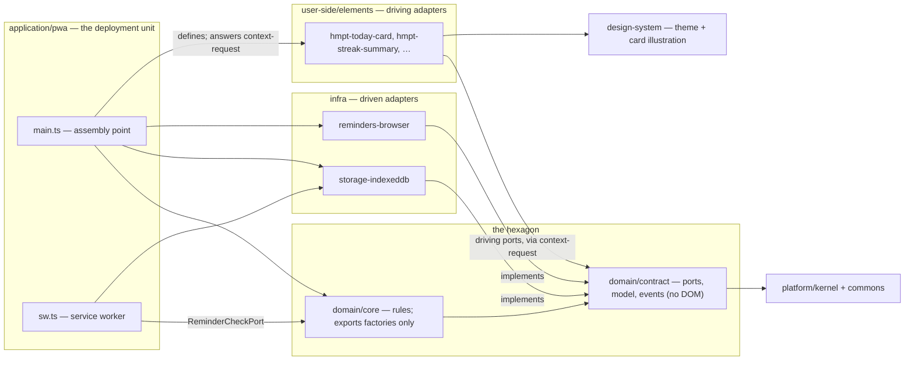

# How Many Pages Today

An offline-first PWA that deals you one reading challenge a day: a card with an illustration
and a number of pages. Read them, tap the button, keep the streak alive.

- **A card a day.** The page count is drawn from a range you control — by default 10 to 100
  in steps of ten — and the card's illustration is painted from a seed, so the same day
  always shows the same card, online or not.
- **Gamified.** Current and best streak, total pages, a ten-rank reader level, sixteen
  achievements, a six-week calendar, and a small fuss when you finish.
- **A profile that never leaves the phone.** Name, avatar, favourite genre, current book —
  all stored in the browser's IndexedDB. There is no server.
- **Daily reminder.** A notification at a fixed hour until you have read; plus a one-tap
  calendar event as the reminder that never misses (see [Reminders](#reminders)).
- **Installable and offline.** Every asset is precached by the service worker.

## Run it

```bash
npm install
npm run dev          # http://localhost:5173/how-many-pages-today/
npm run verify       # typecheck + architecture lint + unit tests + build
npm run e2e          # Playwright against the production build
```

Node 22+. The end-to-end suite needs Chromium (`npx playwright install chromium`).

## Deploy

`.github/workflows/pages.yml` verifies every push and pull request and deploys the
repository's **default branch** to GitHub Pages. One-time setup: *Settings → Pages →
Build and deployment → Source: **GitHub Actions***. The app is then served at
`https://<owner>.github.io/how-many-pages-today/` (change `BASE_PATH` for another host).

## Reminders

A static site has no push server, so the web offers exactly one way to wake an app that
is closed: **Periodic Background Sync** — installed PWAs on Chromium (Android Chrome,
desktop Chrome/Edge), at a cadence the browser decides (roughly, not to the minute).

| Where | What you get |
|---|---|
| Android, app installed | A background reminder around the chosen hour. |
| iPhone/iPad, added to Home Screen | A reminder at the exact hour **while the app is open**; no background wake-up exists for web apps without a push server. |
| Anywhere | **Add to my calendar**: a daily recurring event with an alarm, generated on the device. Your phone's calendar rings it, on the dot, every day. |

A real push server (Web Push) would make background reminders exact on every platform; it
is the natural next step if the app ever gets a backend. See
[ADR 0002](docs/adr/0002-reminders-without-a-server.md).

## Architecture

The house hexagonal reference for the frontend, `basic` layout (one bounded context: the
reading challenge), as an npm workspace. Custom elements are the driving adapters, every
browser capability sits behind a driven port, and the domain compiles without the DOM.
Layout comes from [`@rgoussu.dev/planks`](https://www.npmjs.com/package/@rgoussu.dev/planks).



| Package | Role |
|---|---|
| [`platform/kernel`](platform/kernel) | `Result`, the `Clock`/`RandomSource` port types, the Context protocol |
| [`platform/commons`](platform/commons) | System clock, `Math.random` |
| [`domain/contract`](domain/contract) | Model, driving & driven ports, domain events |
| [`domain/core`](domain/core) | Page draws, streaks, levels, achievements, reminder policy; in-memory fakes |
| [`design-system`](design-system) | Theme tokens over planks; `<hmpt-ds-scene>`, the seeded illustration |
| [`user-side/elements`](user-side/elements) | Port-bound custom elements and their context keys |
| [`infra/storage-indexeddb`](infra/storage-indexeddb) | Every repository port on one IndexedDB database |
| [`infra/reminders-browser`](infra/reminders-browser) | Notification permission, periodic sync, notifications |
| [`application/pwa`](application/pwa) | `index.html` + `main.ts` + router + service worker |

The walls and what enforces them:

| Rule | Enforced by |
|---|---|
| The domain never touches the browser | domain packages compile with `"lib": ["ES2022"]` — `document`, `fetch`, `HTMLElement` do not exist there (tsc) |
| Only the assembly sees the core; adapters talk to the contract | dependency-cruiser |
| Adapters never import each other; the design system is domain-blind | dependency-cruiser |
| No relative import escapes its package (which would bypass `exports`) | dependency-cruiser |
| The core's internals stay internal | `domain/core`'s `exports` map: factories (and `./testing`) only |

The workspace graph enforces nothing on its own — dependency-cruiser does, and it has been
checked to fire on planted violations. Decisions are recorded in [`docs/adr`](docs/adr).
